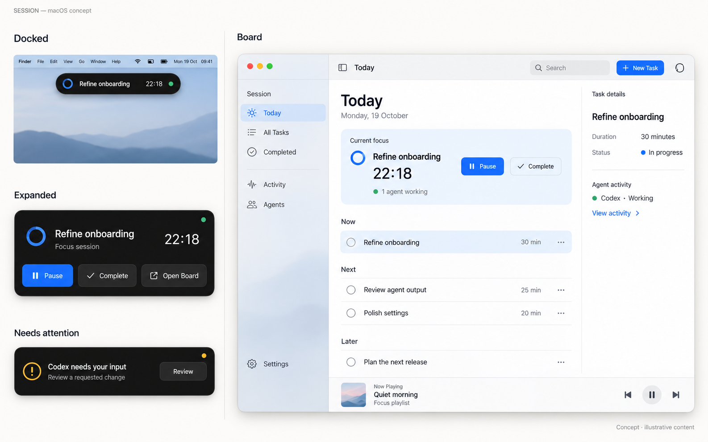

# SESSION — macOS UI revision

Status: concept draft for review, not an approved implementation specification.

Date: 19 October 2026.

Visual concept generated with the built-in image-generation tool. The image shows separate presentation states and illustrative content; it is not a screenshot of an implemented revision. [Generation prompt](assets/2026-10-19-macos-ui-concept-prompt.md).

Current editable Figma design: [SESSION — macOS Island & Board](https://www.figma.com/design/m4repQN9EdKQgGPtJlwk9v?node-id=10-19), revised on 26 October 2026. The whole UI now uses monochrome dark styling. It includes Today, an AI Usage screen, three island states, compact and expanded Spotify players, reusable allowance components, and an unavailable-data state. The Figma preview uses Inter because the connected renderer advertises Apple fonts but renders their glyphs at zero width; SF Pro remains the intended Mac implementation font.

## Direction

A quiet companion above your work, and a focused workspace when you open it.

Tasks and the focus session lead the board. The supporting AI view shows plan allowances, remaining usage, and reset times for Codex, Claude, and Gemini. The user explicitly removed the OpenAI entry and agent/file-update feeds from the proposed UI. The visual direction follows macOS with a black, gray, and white palette, readable content, and contextual controls.

## What the existing UI establishes

Reviewed the current Board and Dock browser views and their source. The browser does not perform the desktop shell's window resizing; Dock dimensions and position were checked in source.

- The dot-matrix font gives SESSION a recognizable identity, but using it for every label, task, and control makes ordinary work harder to scan.
- All-caps labels, bright dividers, and many similarly weighted controls flatten the hierarchy.
- Music takes a large permanent portion of the board even when disconnected, while agent and operator information occupies another full-width region.
- Dock uses the FocusView layout with a timer, title bar, duration controls, reset, complete, view switching, and IDE access. Native geometry is currently 420 × 280 logical pixels, or 420 × 330 with music, positioned at the top right.
- The current custom close/minimize controls and packaging are Windows-oriented. Board and Dock are routed through the same app window.

Preserve the distinction between ambient focus and deliberate planning, task-timer continuity, and honest usage data. In the revised design, provider allowances replace agent progress and file-update telemetry.

## Approaches considered

1. **Top-center island plus a standard Mac board — recommended.** Satisfies the requested island while keeping planning in a familiar resizable window. Requires a dedicated companion panel and deliberate keyboard-focus behavior.
2. **Menu bar companion plus board.** Most conservative Mac utility pattern and uses little screen space, but does not deliver the requested centered island.
3. **Bottom-center floating shelf plus board.** Gives more room for controls, but competes with the system Dock and covers more working content.

## Docked: the Session Island

Use a custom floating macOS panel, centered within the chosen display's usable area, below the menu bar and any camera exclusion area. Do not draw a fake hardware notch. The Dynamic Island is the interaction inspiration; this is a custom Mac companion, not a claim that macOS supplies an iPhone-style island API.

Suggested starting sizes are design hypotheses in points, to validate on a Mac:

| State | Starting size | Content |
| --- | --- | --- |
| Compact | About 320 × 40 | Focus symbol, short task title, remaining time |
| Peek | About 380 × 160 | Full task title, timer, Pause/Resume, Complete, and Open Board |
| Attention | About 380 × 108 | Service name, remaining allowance, reset time, and Usage action |

The capsule uses a near-black surface, readable white text, a subtle edge, and a soft shadow. Only the current time or essential status changes in the compact state. It must remain useful without continuous animation.

### Interaction

- A short hover reveals a read-only peek. Clicking pins the expanded controls; keyboard focus can reach the same controls without hover.
- Clicking Open Board activates the board at its saved position. Do not jump from hover straight into the full board.
- Escape closes the expansion and returns focus to its previous owner. Moving away closes an unpinned peek after a short grace period.
- Passive updates never take keyboard focus. Use a nonactivating companion panel; activate only when the user chooses an action that needs keyboard input.
- Hide the redundant compact island while the board is frontmost, restoring it when the user returns to other work.
- Keep task and timer state in a shared owner so opening or closing either presentation cannot restart a session.
- Remember the chosen display. Stay inside its usable bounds on displays with or without a notch. Offer an explicit display preference; do not chase the pointer between monitors.
- Start with ordinary desktop visibility. Full-screen and Spaces behavior should be an explicit preference, tested on macOS.

### State priority

An allowance approaching its limit can temporarily replace the focus summary with a concise usage alert. Show the service, remaining allowance, and reset time, with a Usage action. The current Figma example is Gemini with 12% left and a reset in 45 minutes.

Use a brief focus-completion acknowledgment and return to the session summary. Missing allowance data displays an unavailable state. The island does not show file modifications, tool execution, or agent approval requests.

Without an active task, show a quiet Ready state and New Task action. A paused timer explicitly says Paused. Timer completion is distinct from task completion.

## Board: a native Mac workspace

Start around 1120 × 760 points, with freely resizable native window behavior. Restore the user's saved size and position.

### Native frame and toolbar

Use real traffic-light window controls at the upper left, a unified toolbar, a sidebar toggle, the current section title, Search, New Task, an inspector toggle, and Collapse to Island. Remove the duplicate clock and persistent PIN button from the task workspace.

Close closes the board window while an ongoing session and the companion continue. Minimize uses the macOS Dock. Collapse to Island is a separate command. Quit ends the application through the application menu or Command-Q.

Provide native application menus and a menu bar status item for reopening the board and accessing the island preference.

### Left sidebar

Use a narrow navigation region, around 200–220 points. Destinations are Today, All Tasks, Completed, and AI Usage, with Settings at the bottom. Connection management belongs in Settings. The sidebar collapses when space is limited.

Avoid inventing project/grouping features in this revision; the current task model does not establish them.

### Main content

The Today view begins with a calm date and title. One integrated focus region presents the active task, remaining time, and a prominent Start or Pause action. Duration and Reset live in a contextual session menu. Complete remains available for the active task.

Below it, show spacious task rows grouped as Now, Next, Later, and Completed. Use a completion control, the task title, an optional duration, and contextual actions. Avoid row numbers, airport-style all-caps tables, and permanent delete icons on every row. Keep task titles selectable and readable.

Task selection opens its detail inspector; starting focus is an explicit action. Completing a task offers Undo. Completed items can collapse so the active queue stays prominent.

The empty state should offer Add Your First Task with one short explanation. Disconnected integrations belong in Settings rather than dominating an empty board.

### Optional inspector

Use a trailing inspector around 280 points for the selected task, session details, or agent details. It appears only when requested and closes with Escape. When the window is narrow, preserve the task area and present details on demand rather than compressing three columns.

AI Usage is available from the focus region and sidebar. The Today inspector contains compact allowance rows for Codex, Claude, and Gemini. A dedicated AI Usage screen presents the same services with larger bars, used allowance, remaining allowance, and reset countdowns. Each service is shown separately; do not aggregate unrelated plan allowances into a single total.

Allowance values and reset times in the Figma file are explicitly labeled Preview data. Missing provider data appears as — and Usage unavailable. The existing application tracks local active-time estimates; those must not be presented as verified plan allowances when this design is implemented.

### Music

Use a slim Spotify Now Playing strip at the bottom when a track exists, with track information and playback controls. The revised Figma file also includes an expanded Spotify player with a track position and transport controls. Open it from the strip; connection management remains in Settings.

## Visual language

- Revision, 26 October 2026: the user approved monochrome dark styling across the whole UI. The [Today board](https://www.figma.com/design/m4repQN9EdKQgGPtJlwk9v?node-id=10-27), [AI Usage screen](https://www.figma.com/design/m4repQN9EdKQgGPtJlwk9v?node-id=10-299), island states, music controls, and components now use black, gray, and white only.
- System San Francisco typography on Mac; sentence case for labels. Use monospaced digits only where a changing number needs stable alignment.
- Prefer near-black content, charcoal navigation and selected surfaces, white primary actions with dark labels, and gray secondary text. Use neutral focus indicators, window controls, status markers, and music controls in the revised concept.
- Apply native materials to navigation and transient controls, with stable, legible backgrounds for tasks and dense content. Do not place glass on every card.
- Use SF Symbols for Mac-native icons, native selected/disabled/hover treatments, and softer separators. Group through spacing before adding enclosing borders.
- Distinguish selection, attention, failure, and completion through contrast, symbols, and explicit text instead of hue.
- Use restrained, interruptible expansion motion. Honor Reduce Motion, Reduce Transparency, increased contrast, VoiceOver, and keyboard navigation. Sound remains optional; existing audio cues are not equivalent to physical Mac trackpad haptics.

## Keyboard and accessibility

Command-N adds a task; Command-F searches; Command-comma opens Settings; Command-W closes the board; Command-Q quits. Expose frequent app-specific commands in menus and let users configure a global island shortcut without taking a system shortcut.

Controls need clear accessible names and visible focus. Do not announce every timer second to a screen reader; announce meaningful session transitions. No essential action depends solely on hover, dragging, color, or sound.

## Mac implementation boundary

The board should be a standard resizable Mac window, and the island a separate companion panel, with shared session state. This replaces the current single-window resize-and-move model.

Retaining React/Tauri for the board is possible as a direction, but native window controls, panel activation, materials, display bounds, menus, and keyboard behavior require macOS integration. A SwiftUI/AppKit presentation is another implementation option if first-party platform fidelity becomes the deciding requirement. Framework selection is outside this draft.

Windows media, capture, packaging, and other OS-specific integrations need a separate macOS capability check. This draft does not claim they already work on Mac.

## Validation before implementation is considered finished

On an actual Mac, review compact and expanded states on a notched laptop and an external display; small and large board sizes; long task titles; correct allowance percentages and reset times; missing or stale usage readings; session continuity when windows change; close/minimize/quit behavior; and keyboard and accessibility settings. The Figma review verified all six visible usage bars against their percentages, with no chromatic paints or file-update feeds in the review canvas.

## Reference basis

- [Apple: Designing for macOS](https://developer.apple.com/design/human-interface-guidelines/designing-for-macos/): windows, menus, keyboard input, and comfortable information density.
- [Apple: Materials](https://developer.apple.com/design/human-interface-guidelines/materials): distinguish navigation and controls from content, and use glass sparingly.
- [Apple: Live Activities](https://developer.apple.com/design/human-interface-guidelines/live-activities): inspiration for compact, minimal, and expanded status presentations. Apple's documented Mac Live Activity location is the menu bar; the proposed island is custom.
- [Apple: Keyboards](https://developer.apple.com/design/human-interface-guidelines/keyboards/): preserve standard shortcuts and support keyboard access.

The reference principles inform this proposal. Placement, sizes, layout, priorities, and interactions above are proposed design decisions, not Apple requirements.
